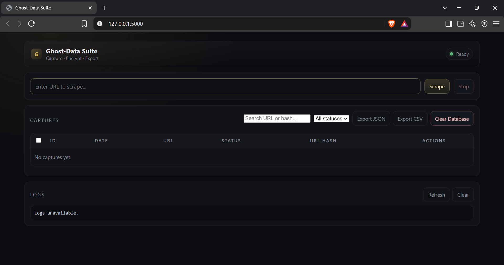

# GhostDataSuite

<p align="center">
  <a href="https://github.com/cjps4linux-creator/GhostDataSuite/actions/workflows/ci.yml"></a>
  <a href="https://github.com/cjps4linux-creator/GhostDataSuite/releases/tag/v1.0.0"></a>
</p>

A hardened, encrypted web scraping and monitoring stack with dashboard, auth, multi-target support, export, metrics, Playwright-based scraping, RQ task queue, automated backups, and Windows launcher (.exe).

<p align="center">
  
</p>

## Quick Start

### Option 1: Windows (.exe) — Recommended for desktop use

1. Download `dist/ghost-data-suite.exe` from the [Releases](https://github.com/cjps4linux-creator/GhostDataSuite/releases) page.
2. Double-click `dist/ghost-data-suite.exe` (or run `scripts/launch-ghost-exe.bat`).
3. The backend auto-starts on `http://127.0.0.1:5000/` and the dashboard opens in your default browser.
4. `GHOST_AUTH_TOKEN` and `SECRET_KEY` are auto-generated on first launch — no setup required.

### Option 2: Docker

```bash
cd path/to/GhostDataSuite
docker compose up -d --build
```

Then open: http://localhost:5000/

## Structure

| Path | Purpose |
|------|---------|
| `src/ghost_server.py` | Hardened Flask API + SocketIO + metrics + backup scheduler |
| `src/scraper.py` | Multi-target Playwright scraper with plugin hooks |
| `src/tasks.py` | RQ scrape job (browser-per-job, async via Redis) |
| `src/db_store.py` | Dual-mode SQLite/PostgreSQL encrypted store |
| `src/security.py` | Shared SSRF guard + safe URL fetching |
| `src/logging_config.py` | Structured JSON logging |
| `dashboard.html` | Full dashboard with auth, search, export, live logs |
| `dist/ghost-data-suite.exe` | Standalone Windows executable (PyInstaller) |
| `scripts/launch-ghost.bat` | Source-mode Windows launcher (venv Python) |
| `scripts/launch-ghost-exe.bat` | EXE launcher wrapper (kills stale port, sets Playwright path) |
| `scripts/install-windows-service.ps1` | Register .exe as a Windows service |
| `systemd/ghost-data-suite.service` | Linux systemd unit (user 1000:1000, security hardening) |
| `config/config.yaml` | Targets, auth token, intervals |
| `nginx/` | TLS termination, security headers, reverse proxy |
| `monitoring/` | Prometheus, alert rules, Grafana dashboards |

## Auth

Set `GHOST_AUTH_TOKEN` in environment or `.env`. The dashboard uses the `X-Ghost-Token` header or an `httpOnly` cookie (`ghost_token`). Tokens never appear in URLs or `localStorage`.

On direct `.exe` launch without env vars, `GHOST_AUTH_TOKEN` and `SECRET_KEY` are auto-generated and served to the frontend via `/static/auth-config.js`.

## API

| Endpoint | Method | Description |
|----------|--------|-------------|
| `/` | GET | Dashboard |
| `/health` | GET | Health check |
| `/status` | GET | DB stats, key status, auth enabled |
| `/captures` | GET | List captures (`?q=hash&status=ok\|error`) |
| `/captures/<id>/decrypt` | GET | Decrypt and view capture content |
| `/captures/<id>/media` | GET | List media for a capture |
| `/captures/bulk` | POST | Bulk delete captures |
| `/export/json` | GET | Export all captures as JSON |
| `/export/csv` | GET | Export captures as CSV |
| `/logs` | GET | Tail server logs |
| `/logs/clear` | POST | Clear logs |
| `/scrape` | POST | Trigger scrape (`{"url", "interval", "once"}`) |
| `/scrape/stop` | POST | Stop manual scrape target |
| `/backup` | GET | Download encrypted backup ZIP (DB + key + logs) |
| `/restore` | POST | Upload and restore backup ZIP |
| `/metrics` | GET | Prometheus metrics |
| `/notify/capture` | POST | Scraper → server notification callback |
| `/local-media/<id>/<file>` | GET | Serve captured media file |
| `/public/media/<id>/<file>` | GET | Proxy remote media (SSRF-protected) |
| `/media/download/<id>/<file>` | GET | Download captured media |
| `/download/all/<id>` | GET | Download all media as ZIP |

## Environment Variables

| Variable | Default | Description |
|----------|---------|-------------|
| `GHOST_AUTH_TOKEN` | *(auto-generated)* | API/dashboard auth token |
| `SECRET_KEY` | *(auto-generated)* | Flask secret key |
| `GHOST_PORT` | `5000` | Server listen port |
| `GHOST_HOST` | `0.0.0.0` | Server bind host |
| `DB_PATH` | `data/alchemy.db` | SQLite database path |
| `DATABASE_URL` | *(empty)* | PostgreSQL connection string (overrides SQLite) |
| `ENCRYPTION_KEY_FILE` | `keys/master.key` | Fernet master key path |
| `SECRET_FILE` | `keys/secret.key` | Flask secret key path |
| `REDIS_URL` | `redis://localhost:6379/0` | Redis for RQ + rate limiting |
| `QUEUE_NAME` | `ghost-scrapes` | RQ queue name |
| `GHOST_SERVER_URL` | *(empty)* | Base URL for scraper notifications |
| `PLAYWRIGHT_BROWSERS_PATH` | *(auto-detected)* | Path to Playwright browser binaries |
| `SCRAPE_DOMAIN_MIN_DELAY` | `2.0` | Minimum seconds between scrapes per domain |
| `RATE_LIMIT` | `300 per minute` | Global Flask-Limiter rate limit |
| `LOG_LEVEL` | `INFO` | `INFO`, `DEBUG`, or `ERROR` |
| `JSON_LOGS` | `true` | Structured JSON logging on/off |
| `OTEL_EXPORTER_OTLP_ENDPOINT` | *(empty)* | OpenTelemetry collector endpoint |
| `BACKUP_INTERVAL_SEC` | `86400` | Automated backup interval (seconds) |
| `BACKUP_KEEP` | `7` | Number of backups to retain |
| `BACKUP_DIR` | `data/backups` | Backup output directory |
| `MEDIA_DIR` | `media` | Scraped media storage |
| `SILENT_MODE` | `false` | Reduce log verbosity |

## Security

- **SSRF protection**: All outbound URL fetching validated through `src/security.py` — only `http`/`https` schemes allowed.
- **Token auth**: `X-Ghost-Token` header or `httpOnly` cookie; tokens never in URLs.
- **Rate limiting**: Flask-Limiter with Redis backend (production) or in-memory (dev); `/scrape` limited to 5/min.
- **Path traversal**: Media file serving validates resolved paths stay inside `MEDIA_ROOT/<capture_id>/`.
- **No secrets in repo**: `.env`, `*.key`, `keys/`, `data/`, `logs/`, `media/`, `backups/` are all gitignored.
- **Container security**: `user: "1000:1000"`, `no-new-privileges`, `read_only` rootfs, `tmpfs` for `/tmp`.
- **Error responses**: Generic messages to clients; full tracebacks logged server-side only.

## Scraping

Powered by Playwright Chromium. Each RQ worker job launches its own browser instance (browser-per-job grid pattern). Malformed URLs, IPv6 literals without brackets, and hash-like paths are rejected before they reach `urlparse()`.

### From the dashboard

Enter a URL and click **Scrape**. The job is enqueued via RQ (or runs synchronously when Redis is unavailable). Results appear in the captures list with encrypted content and captured media.

### From the API

```bash
curl -X POST http://localhost:5000/scrape \
  -H "Content-Type: application/json" \
  -H "X-Ghost-Token: YOUR_TOKEN" \
  -d '{"url":"https://example.com","once":true}'
```

## Backups

Automated backups run in a background thread (default every 24h, keep last 7). Each backup ZIP contains `alchemy.db`, `master.key`, and `alchemist.log`. Manual backup/restore via `/backup` and `/restore` API endpoints.

## Deployment

### Windows Service (Auto-start on boot)

```powershell
# Run as Administrator
scripts\install-windows-service.ps1
net start GhostDataSuite
```

### Linux systemd

```bash
sudo cp systemd/ghost-data-suite.service /etc/systemd/system/
sudo systemctl daemon-reload
sudo systemctl enable --now ghost-data-suite
```

### Docker Compose (Production)

```bash
docker compose -f docker-compose.prod.yml --profile production up -d
```

Includes Nginx TLS termination, security headers, Redis, RQ worker, and optional Prometheus/Grafana monitoring.

## Testing

```bash
pip install -r requirements.txt -r requirements.ghost.txt
pip install pytest pytest-cov
pytest -q --no-header
```

269 tests passing (3 skipped for Docker integration).

## Linting

```bash
pip install ruff==0.17.1
ruff check src/
```

## CI/CD

GitHub Actions runs on every push to `main`:
- Lint (ruff)
- Test (pytest)
- Bandit security scan
- Docker build + Trivy vulnerability scan
- Optional staging/production deployment (gated by repository variables)

---

Built by **Conrad CJ Wilson** — [GitHub](https://github.com/cjps4linux-creator) · [LinkedIn](https://linkedin.com/in/conradcjwilson)
